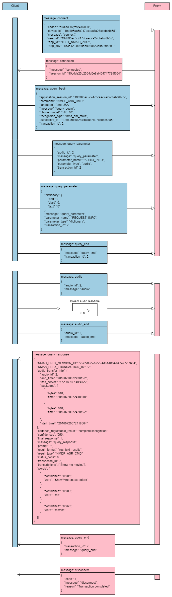
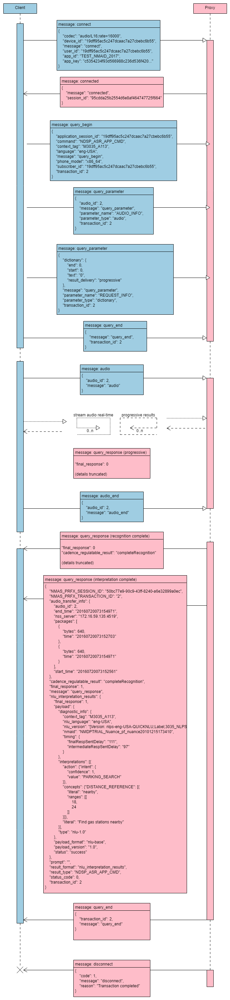
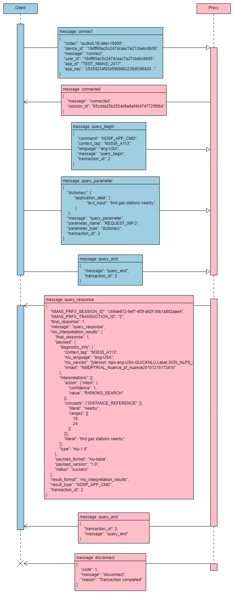
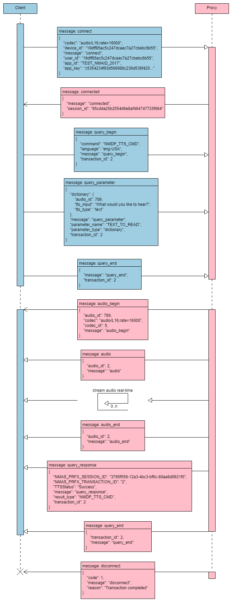
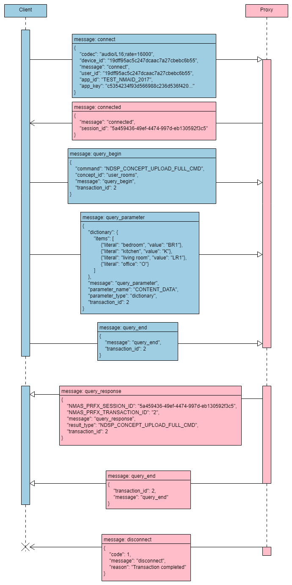
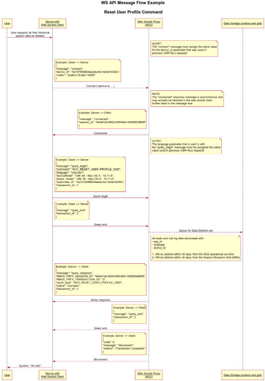

<h3 id="heading_speech_synthesis_parameters">Commands</h3>

In order to employ the various services described above, NCS offers commands that are sent in the query_begin message. The following commands map to their respective services.

| Name     | Description                           |
|----------|---------------------------------------|
| NMDP_ASR_CMD | Speech Recognition |
| NMDP_TTS_CMD | Text to Speech |
| NDSP_APP_CMD | 	Text NLU | 
| NDSP_CONCEPT_UPLOAD_FULL_CMD | Upload User Data | 
| NDSP_CONCEPT_UPLOAD_INCREMENTAL_CMD | Incremental Data Upload | 
| NDSP_DELETE_ALL_CONCEPTS_DATA_CMD | Delete All User Data |
| NVC_RESET_USER_PROFILE_CMD | Delete User's Profile |
| NVC_DELETE_SESSION_DATA_CMD | Delete session's data |

> ASR command call flow:

> ASR with NLU using NDSP_ASR_APP_CMD command call flow:

> NLU command with NDSP_APP_CMD call flow:

> TTS command with NMDP_TTS_CMD call flow:

> Upload user data command with NDSP_CONCEPT_UPLOAD_FULL_CMD call flow:

> Reset user profile with NVC_RESET_USER_PROFILE_CMD call flow:

